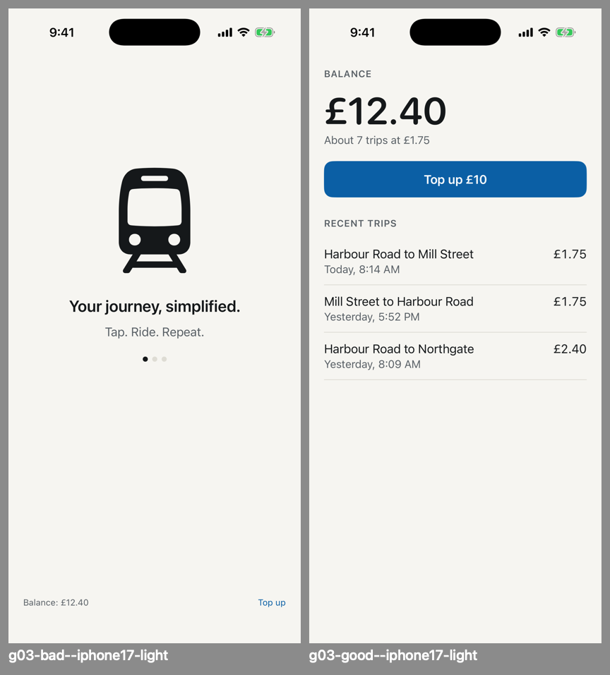
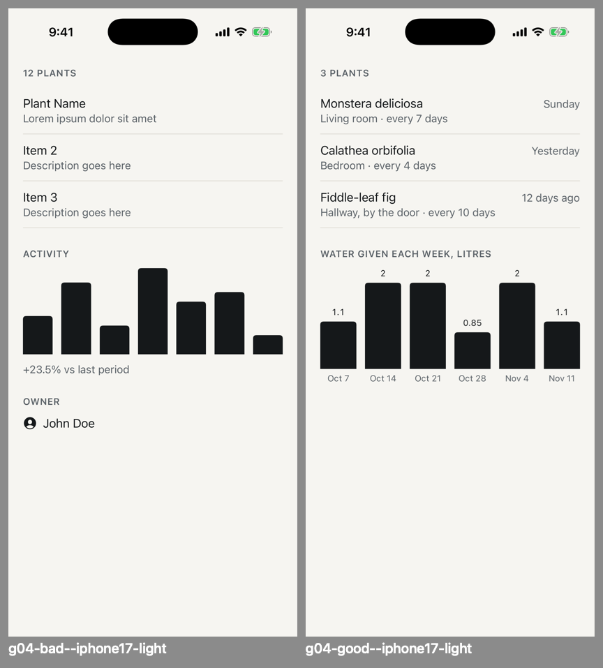
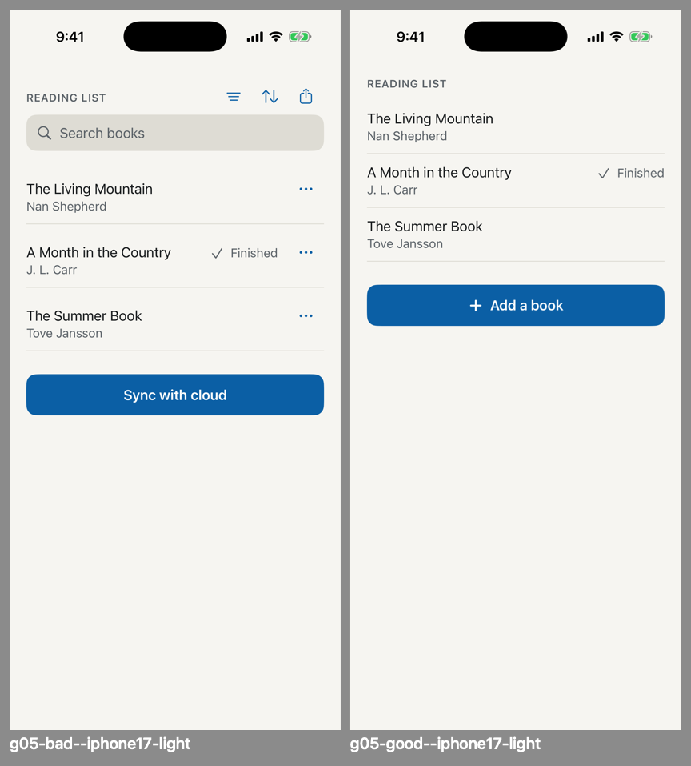
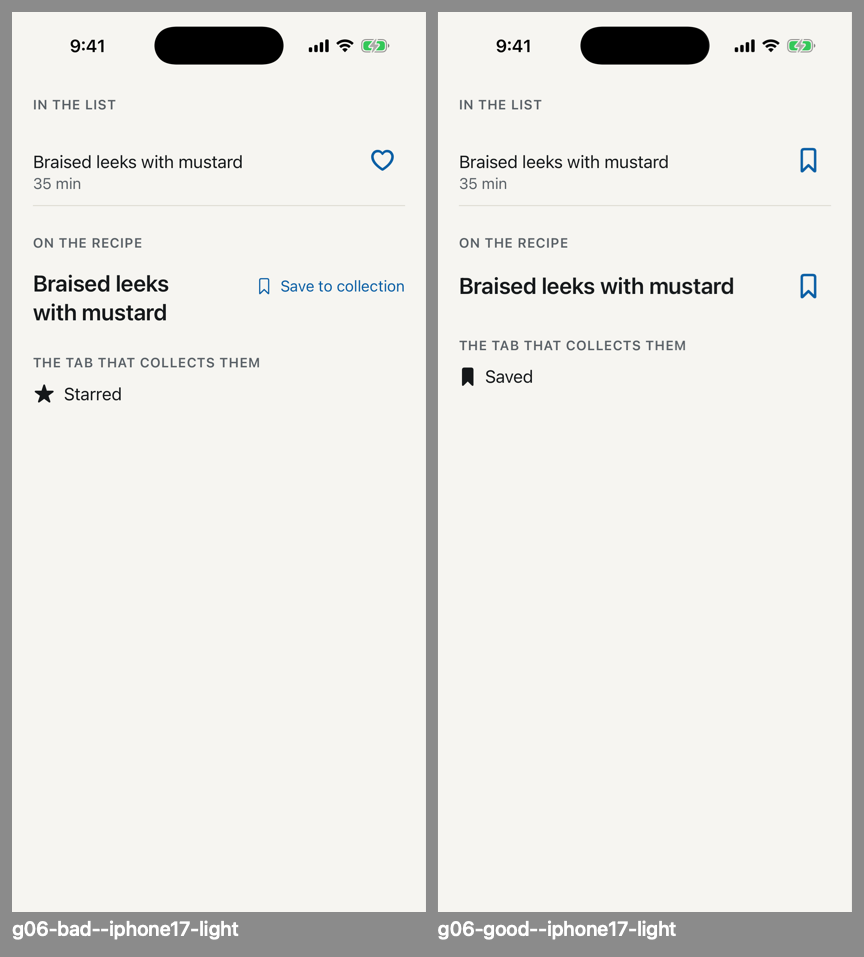
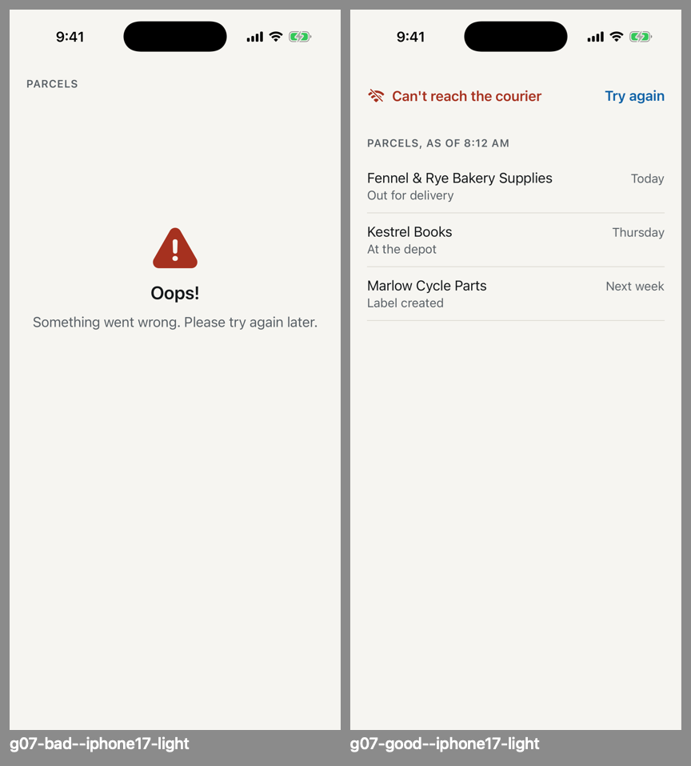
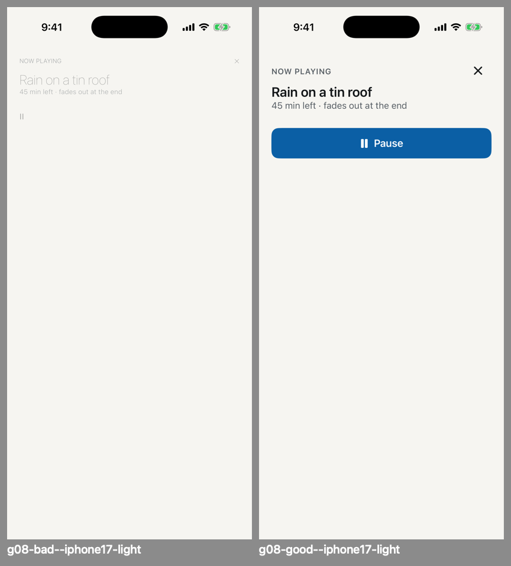
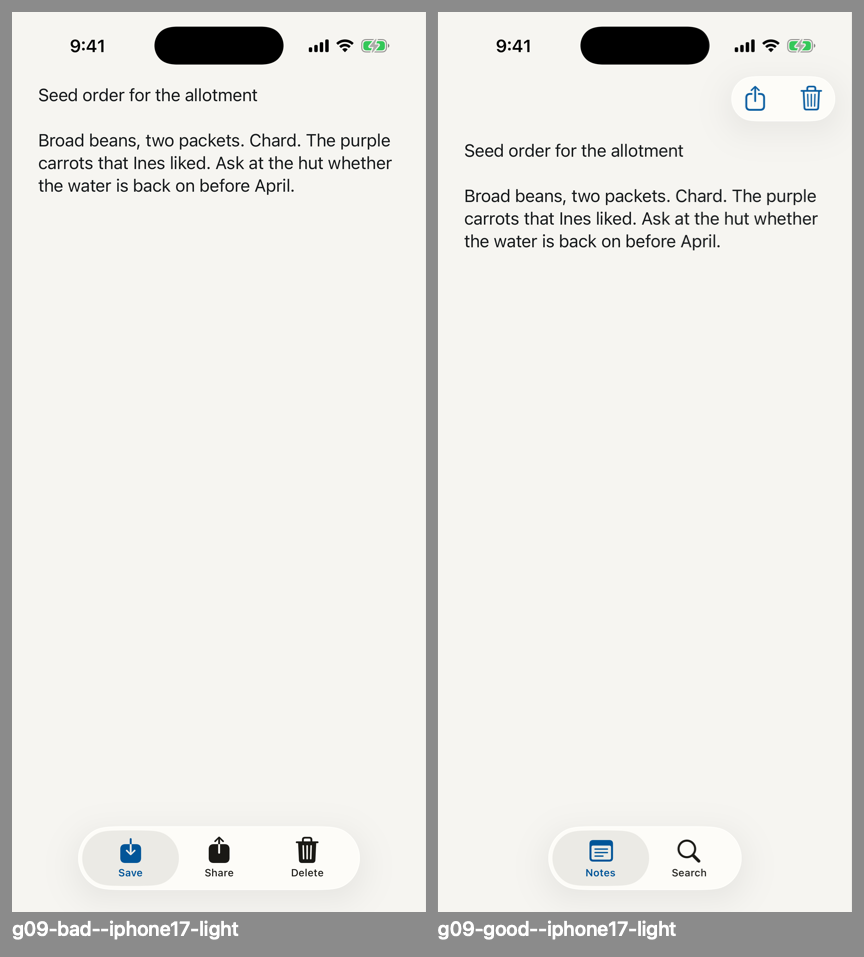
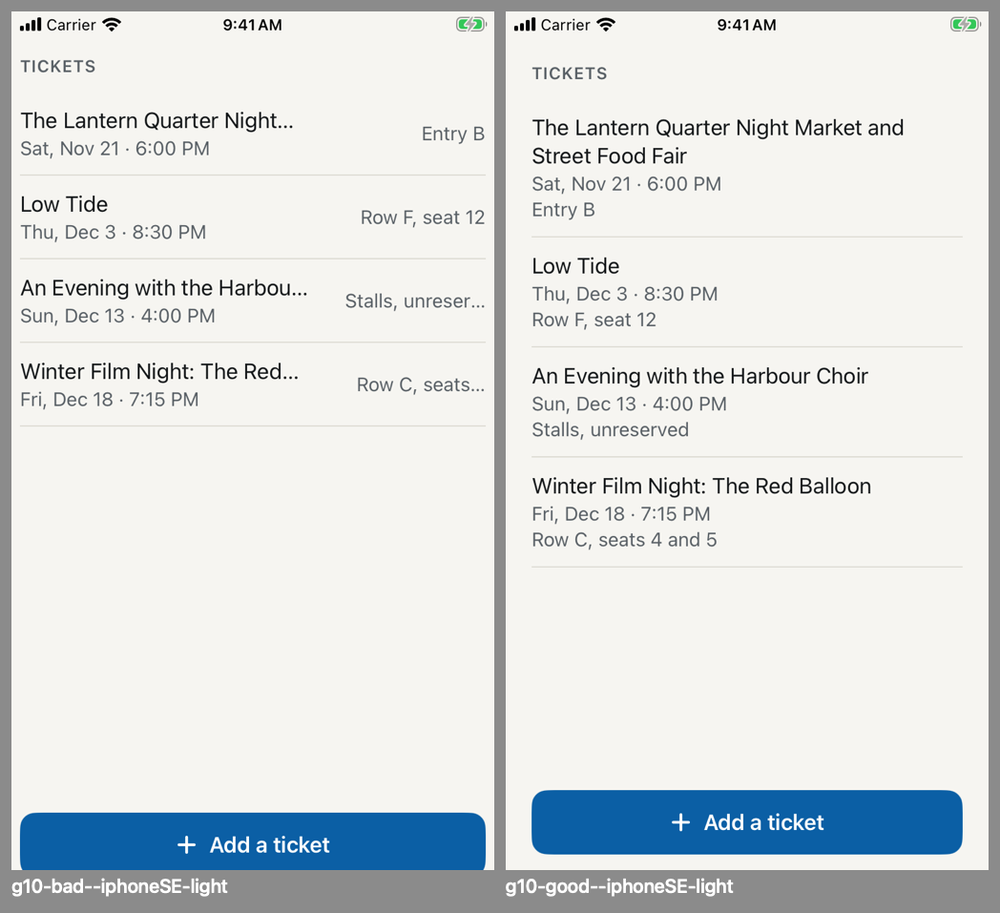
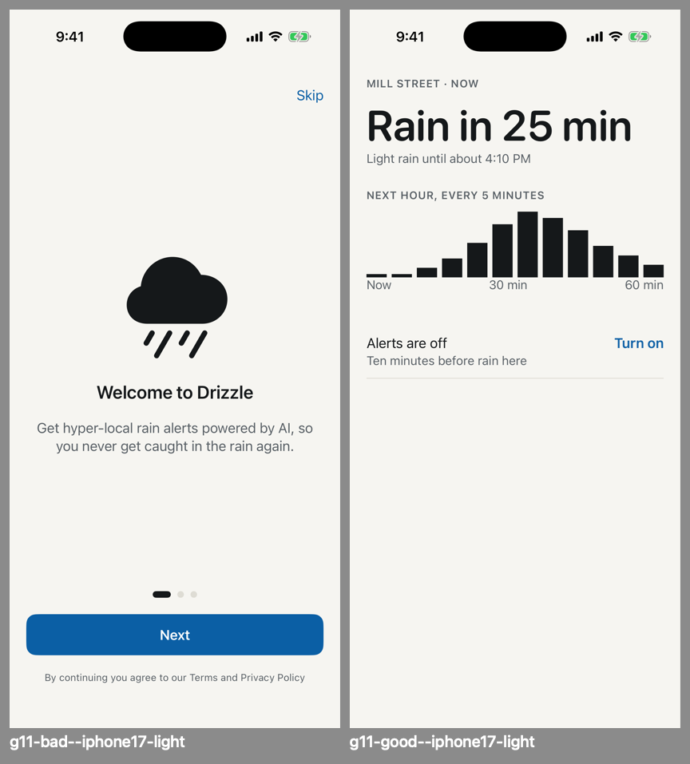
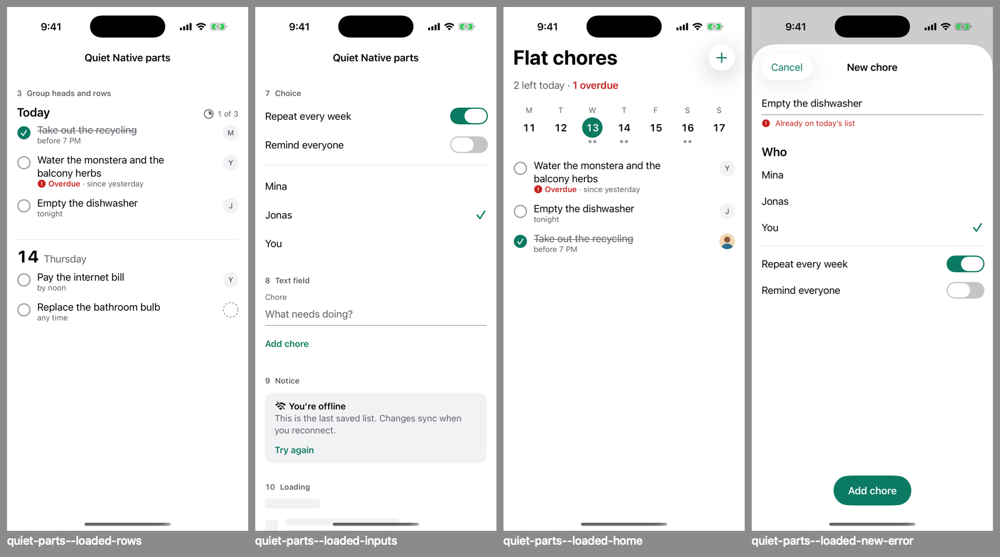

# Guard rules

Things to stop doing. Each rule says when it applies, what to do instead, what the failure looks like,
when it is not a failure, and how to check.

Status: eleven rules. G1 and G12 came from reviews of this library's own screens. G3 to G11 answer
a checklist of failures common in generated interfaces; each has a bad and a good screen, built and
pictured. The numbers are names and stay fixed: G2 was withdrawn and its number is not reused.

| Rule | Run it when |
| --- | --- |
| [G1. No caption for what the screen already says](#g1-no-caption-for-what-the-screen-already-says) | you are about to write any sentence |
| [G3. Decoration never outranks content](#g3-decoration-never-outranks-content) | you add a picture, a slogan or an effect that carries none of the content |
| [G4. Real words and figures that agree](#g4-real-words-and-figures-that-agree) | you write sample data, a count or a date |
| [G5. No control that does nothing](#g5-no-control-that-does-nothing) | you add a control |
| [G6. One name and one icon for one thing](#g6-one-name-and-one-icon-for-one-thing) | the app has a second screen |
| [G7. A failure says what failed and what to do](#g7-a-failure-says-what-failed-and-what-to-do) | you design a failed, empty or refused state |
| [G8. Readable and pressable before pretty](#g8-readable-and-pressable-before-pretty) | you choose a text colour or draw a small control |
| [G9. System parts for the jobs they are made for](#g9-system-parts-for-the-jobs-they-are-made-for) | you use a tab bar, a toolbar, a sheet or an alert |
| [G10. Not laid out for one screenshot](#g10-not-laid-out-for-one-screenshot) | you type a width, a height or a line limit |
| [G11. No ceremony before the job](#g11-no-ceremony-before-the-job) | you design what happens at first launch |
| [G12. A screen reads in one pass](#g12-a-screen-reads-in-one-pass) | you place more than a handful of things on a screen, or look at its first screenshot |

## G1. No caption for what the screen already says

A caption, a helper line or a sentence of explanation is extra whenever the interface can carry the
same meaning by itself. Decide this before writing the text, not after.

### Applies when

You are about to add any of these: a description under a title, a line of advice under a value, a
subtitle on a row or card, helper text under a control, a hint beside a button, a sentence in an empty
state, a sentence confirming something that just happened, a word that names the form or the state a
thing is visibly in, or a label over a group that needs no name.

### Do

1. Name what the text would tell the person.
2. Look for something already on the screen that tells them the same thing: a label, a value with its
   unit, a verdict word, an icon with its word, a badge, or the title of the button right beside it.
3. If something does, do not write the text.
4. If the screen almost says it, change the screen instead of adding a sentence to cover for it. Rename
   the button, add the unit, move the value next to its label.
5. If the text stays, cut it to the part the screen cannot show. Beside a "Try again" button, "You're
   offline." is enough; "Check your connection and try again." repeats the button.

Text that usually earns its place, because nothing else on the screen can show it:

- A state that cannot be seen: offline, an old reading, changes waiting to sync.
- Why something failed.
- A consequence that cannot be undone.
- What a bare value means when people cannot judge it: "low", "0.6° warmer than usual".

### Common failures

- A sentence above two buttons that says what the two buttons say.
- A paragraph of advice under a status that already has a verdict word and an action.
- A subtitle on every row or card that rewords its title.
- A thank-you or a confirmation sentence beside a badge that has already changed to show the result.
- "Tap + to add" next to a visible plus button.
- A line at the top of a screen describing what the screen is for.
- Helper text under a field that repeats the field's label.
- A word under a thing that names what it visibly is: "Loaded" under a picture, "Busy" under a
  button that shows a spinner, "Off" under a greyed button.
- A note beside a control that says what pressing it did, when the screen has already changed.
- A name over a field on a sheet whose title names that one field.
- A sample or a demonstration screen laid out as a catalogue, with a label on every specimen. The
  labels belong in the document beside it. Agents copy what the samples do.

### Not a failure

- A first-run or empty screen where the next step is truly not obvious and no button can carry it.
- A destructive action. Say what will be lost.
- A value or unit most people cannot judge. Keep the short comparison.
- Legal, safety and privacy wording that has to be there.
- A product whose content is explanation: a guide, a lesson, an article.
- Accessibility labels, values and hints. They are not captions. This rule never removes them, and a
  control that loses its visible caption still needs its accessibility label.

### Verify

1. Hide each caption and explanatory sentence in turn. If the screen still says what is going on and
   what to do next, the text stays out.
2. List every sentence left on the screen. Beside each one, write what it carries that no label,
   value, icon or control carries. A sentence with nothing beside it goes.
3. Look at the empty, failed and success states as well as the loaded one. Explanations pile up there.
4. After cutting, check the largest text size and VoiceOver again. Nothing essential may have lived
   only in the text that was removed.

### Basis

Our choice, set in the review of the test entries on 2026-11-15: the two sentences of advice under the
hero number were judged extra, and the rule was stated as "when the interface can explain it, the
caption is extra."

HIG, Writing (read 2026-11-15) points the same way for wording in general: "If you can use fewer
words, do so." It also asks for clear next steps on blank screens, which a button can provide.

The references do not all agree. In the promotional images, WHOOP and Oura both put a sentence or more
of explanation beside the score (`whoop/03`, `oura/01`), and Flighty states the reason for a status in
a sentence under its badge (`flighty/04`). This rule departs from them on purpose.

### What applying it changed in the test entries

| Entry | Removed | What already said it |
| --- | --- | --- |
| One hero metric | Two sentences of advice under the scale | The verdict word, the plate colour and the reminder button |
| One hero metric | The sentence in the no-sensor state | The title and the "Pair a sensor" button |
| One hero metric | "Connecting to the sensor…" as its own line | The label above the number, which now reads "CO₂ · connecting" |
| Sectioned list | The sentence in the empty state | The two buttons under it |
| Context sheet | The sentence in the no-results state | The "Search a wider area" button |
| Context sheet | "Thanks — other people will see it." after a report | The badge, the greyed button and the changed pin |
| Context sheet | "Check your connection and try again." | The "Try again" button. "You're offline." stays, as the cause |

### Where it shaped the later entries

These entries were written with the rule in place, so nothing was removed. This is what was left out.

| Entry | Left out | What says it instead |
| --- | --- | --- |
| A long read | A message after bookmarking | The bookmark glyph, which fills |
| A long read | A line under the title describing the article | The title and the text itself |
| A day in colour blocks | A legend for the category colours | The icon in each block |
| A day in colour blocks | A message after ticking a block | The block, which becomes a struck-through line |
| A one-tap log | "Saved" after a press | The new block, the count, and the undo key that names the amount |
| A one-tap log | A sentence of praise on reaching the goal | The full stack, the marked top block and today's tick |
| One thing, in figures | A sentence under each figure saying what it means | The comparison under the figure, and the state line at the top |
| One thing, in figures | A message after "Check now" | The line under the state, which now reads "Checked just now" |
| One thing, in figures | A legend for the chart's colours | The scale line the slow bars cross |
| A take in progress | "Recording saved" after a stop | The saved take, which appears as a row with a play control |
| A take in progress | A hint beside the gain ruler | The value written beside its label, which changes as the ruler moves |
| A plain draft | A save button, and "Saved" after a pause | Nothing: every change is kept, and only a failure to sync is reported |
| A plain draft | Tips on the empty page | The caret, the keyboard and two words of placeholder |
| A check-in without a score | Praise or reassurance after an answer | Nothing: the answer is shown as its mark and its word, the same way for every level |
| A check-in without a score | "Note added" | The note button, whose title changes from "Add a note" to "Edit note" |
| A canvas | "Shape added" after adding one | The shape, on the page and selected, with its controls in the strip |
| A canvas | A hint beside the selection handles | The handles themselves |
| A wall of pictures | "Reserved!" after reserving | The badge on the picture, which now reads "Reserved · collect by Friday" |
| A wall of pictures | A caption under the lead picture | The title and the facts on the picture |
| A scene that is the reading | A sentence saying the tide is coming in | The arrow and the word "Rising", and the sea itself |
| A scene that is the reading | A caption explaining the scrubber | The hours written under it, and the scene changing as it moves |
| A wait with a picture | Praise, or a message, when the time is up | The dough at the band, the word "Ready", and the main button, which now names the next step |
| A wait with a picture | A progress bar or a percentage under the picture | The dough's height against the band |
| A wait with a picture | "10 minutes added" | The minutes and the clock time, which change beside the pill |

The one-tap log departs from its references here: Duolingo, Finch and (Not Boring) Habits each show a
celebration screen with words (`duolingo/06`, `finch/05`, `not-boring-habits/04`). So does "One thing,
in figures": Athlytic, Flighty and Copilot Money each explain a figure in a sentence or a paragraph
(`athlytic/03`, `flighty/04`, `copilot-money/03`).

Text that was kept in these entries, and why: "The first check runs within a minute." on the empty
monitor page (when figures will appear cannot be seen); "The take is saved up to 00:04:12." when the
input is lost (what was kept cannot be seen); "Your changes are saved on this iPhone." when a draft
cannot sync (where the words are cannot be seen); "about your usual for a Tuesday morning" after a
check-in (a comparison with the person's own usual is not on the screen any other way); "This is this
morning's catalogue. Reserving needs a connection." on the offline picture wall (it says what is stale
and why the button is gone).

The check-in departs from Gentler Streak, which puts a sentence or a paragraph of encouragement on
three screens (`gentler-streak/03`, `/04`, `/06`).

Kept in the wait with a picture: "Ready about 2:10 PM" under the minutes (the clock time is not on
the screen any other way); "Paused" in its place (in a glance, a stopped timer looks the same as a
running one); "Doubled" on the band (what the mark means cannot be seen); "Alerts are off" (a state
that cannot be seen, and it decides whether the person may walk away).

Checked in simulator screenshots only. Whether people miss any of the removed text has not been tested.

### What it changed in the parts of three looks

The parts of looks 01, 03 and 05 were first set out as a catalogue: a numbered label over each
group, a word under each specimen and a note beside each live control. In the review of
2026-11-17 the labels and notes were judged too many, and the layout distracting. Each look's
parts are now shown in use, on screens of its product, and the names moved to `parts.md`.

| Removed | What says it instead |
| --- | --- |
| "Loaded", "Waiting", "Could not load" under three pictures | The picture, the empty frame and the frame with a mark, each on its own screen |
| "A photograph", "An initial", "Nobody yet" under three people | The three marks, each on a row with a name |
| "Busy", "Off", "Second button" under buttons | The button itself: a spinner and "Adding…", a grey fill, words with no box |
| "Press it. 5 chores", "Copied 5 chores", "Added Viola" beside controls | The new row on the list, and the sentence or the count that changes |
| "Something is late", "Nothing is late", "Done" beside three summary sentences | One sentence at a time, which changes as chores are ticked |
| "First run and About. Not in the bar" beside the app's mark | Where the mark is: at the foot of a screen about the flat, with the version |
| A numbered label over every group: "4 Pictures, people and logos" | Nothing. `parts.md` names each part and where it is in code |
| "Chore" over the one field of a sheet titled "New chore" | The sheet's title and the field's prompt |
| "A service appears here once you add its address." in an empty state | "No services yet" and the "Add a service" button |

## G3 to G11: how to read them

Each of these nine answers one pattern from a checklist of failures common in generated interfaces.
Each has a pair in `../library/pairs/Sources/`: one invented product built twice, with the failure
and without it. The picture under each rule shows both, the bad side on the left. The pairs were
built and screenshotted in the simulator, and a UI test has pressed every control on the good sides
and every control that is meant to work on the bad sides (`../library/pairs/UITests/PairsTour.swift`).
Nobody has tested them with people.

The two sides of a pair are drawn in one look (`../library/pairs/Sources/PairLook.swift`) with the
same content, and differ in the failure and in nothing else. So no colour, effect or style in a
picture is the thing to avoid. A gradient, a glow, a glass card and a boxed card can all be good
design, and a look of your own may use any of them. These rules are about what a choice does to
the content: whether it can be found, read, pressed and trusted.

The grades are the library's: "HIG" names the page and the day it was read, and "Our choice" gives a
reason. Two papers on interfaces made by generative tools are cited where they bear on a rule.
Neither studied native iPhone apps, so they show that a failure happens, not how often it
happens in SwiftUI. No rule here is graded from the reference apps, because the reference images
have not been looked at for these patterns.

## G3. Decoration never outranks content

The largest and brightest thing on a screen is the thing people came to read or press. A gradient,
a glow, a glass card or an illustration can be good design, and can be the look itself. What fails
is rank: something that says nothing about the content takes the first screenful, and the figure
or the action is left small underneath.

### Applies when

You are about to add a hero picture, a slogan, an illustration or an effect that carries none of
the content.

### Do

1. Name what the decoration tells the person. If the answer is "nothing", it is decoration.
2. Let decoration take no room from content. It sits behind the content or beside it, and the first
   screenful still holds the figure and the action.
3. Give the figure or the action the largest size on the screen.
4. If a picture is wanted, make it carry the reading, as directions 07 and 08 do.

### Common failures

- A picture and a slogan that fill the first screenful, with the balance in small type under them.
- The main action as a small link at the bottom of that screen.
- A row of page dots under a picture that has no second page.
- An illustration from a stock set that would suit any app.

### Not a failure

- A gradient ground, a glow, a glass card or any other effect that belongs to the look, when the
  content is still the first thing read and its text passes its contrast figure (G8). The style is
  not what this rule stops.
- A picture that is the content: a scene that shows the tide, a jar that shows the dough, the
  photograph of the thing for sale.
- A brand's own ground colour, when the text on it still passes its contrast figure.

### Verify

1. Squint at the screenshot. The first thing you can make out is the content.
2. Cover the decoration with a hand. What the person came for is still on the first screenful.
3. Measure the text that sits on any decoration (the `measure` tool, G8).

### Basis

Our choice. No study read for these rules measures it. An earlier pair for this rule drew its bad
side with a gradient, glows and a glass card. A review found that this made the style look like
the failure, and the pair was rebuilt in one look.

### The pair



`../library/pairs/Sources/G03.swift`. Both sides use the same colours and type. Bad: a picture of
a tram, "Your journey, simplified." and page dots fill the screen; the balance is at the bottom in
the smallest type with "Top up" as a small link, and the trips are off the screen. Good: the
balance at 52 points, "Top up £10" under it, and the trips.

```swift
// Bad
Image(systemName: "tram.fill").font(.system(size: 120))
Text("Your journey, simplified.").font(PairLook.title)
Text("Balance: \(balance.formatted(.currency(code: "GBP")))").font(PairLook.note)

// Good
Text(balance.formatted(.currency(code: "GBP"))).font(PairLook.figure)
Button("Top up £10") { balance += 10 }.buttonStyle(PairMainButton())
```

## G4. Real words and figures that agree

Every word on the screen is one the product would really show, at a length it would really have.
Every figure has a unit, and the figures agree with each other and with the clock.

### Applies when

You are writing sample data, a label, a count, a chart or a date.

### Do

1. Use real names at real lengths, with one long one. "Fiddle-leaf fig", not "Item 3".
2. Take every count and total from the data. Never type "12 plants" over a list.
3. Give every figure its unit, and every chart a head that says what it measures.
4. Fix the sample's clock, and make dates and "in 6 days" agree with it and with the status bar.
5. Invent a whole product. For a real one, invent nothing: ask, or mark the gap.

### Common failures

- "Lorem ipsum", "Item 2", "Description goes here", "John Doe", "$1,234.56".
- A head that says 12 over three rows; a total that is not the sum of its parts.
- Columns with no unit and nothing under them, and "+23.5% vs last period" with no period.
- "In 7 hours" beside a time that is not seven hours after the clock at the top.

### Not a failure

- A placeholder inside an empty field, which is there to show the format.
- A loading state drawn as plain blocks.

### Verify

1. Add up every total on the screen by hand.
2. Read every date against the status bar.
3. Search the source for "Lorem", "Item ", "John", "Jane", "Example" and "goes here".

### Basis

Our choice, from rule 3 of `SKILL.md`. In this project's comparison, one app built without the
skill showed "In 7 hours" for an appointment at 8:33 AM under a status bar reading 10:12. Sun and
Baber (2025) report that three image generators "had problems with legible text" when asked for
pictures of an interface; that is about generated pictures, not code.

### The pair



`../library/pairs/Sources/G04.swift`. Both sides draw the same column chart. Bad: "12 plants" over
three rows of placeholder text, columns headed "Activity" with no unit and no dates, "+23.5% vs
last period", and "John Doe". Good: three named plants, a head that counts them, and columns headed
"Water given each week, litres" with a date under each and its total above. The six totals are
worked out in the source from each plant's amount and interval, so they cannot disagree with the
list.

```swift
// Bad
PairHead("12 plants")
PairRow(name: "Plant Name", detail: "Lorem ipsum dolor sit amet") { EmptyView() }
PairHead("Activity")
Columns(values: [40, 75, 30, 90, 55, 65, 20])

// Good
PairHead("\(plants.count) plants")
PairRow(name: plant.name, detail: "\(plant.place) · every \(plant.every) days") { Text(plant.last) }
PairHead("Water given each week, litres")
Columns(values: weeks.map { $0.litres }, tops: /* each total */, feet: weeks.map { $0.start })
```

## G5. No control that does nothing

If it can be pressed, pressing it does what it says. A feature that is not built has no control.

### Applies when

You are about to add a search field, a filter, a sort menu, a share or export button, a "more"
menu, a settings gear or a tab.

### Do

1. For each control, name the code that runs when it is pressed. No code, no control.
2. Leave out what is not built, and list it in the report under what was not built.
3. Press every control once in the running app (step 7 of `SKILL.md`).

### Common failures

- A search field that filters nothing.
- Three icons in the bar, each with an empty action.
- A menu on every row that opens nothing.
- "Sync", "Export" or "Upgrade" drawn because apps of this kind have one.

### Not a failure

- A control that is present and unavailable, with the reason visible: "Renewals left: 0".
- In a sample, an action that stands in for a system call, said so in a comment: flipping a value
  where the real app would ask for a permission.

### Verify

1. Search for empty actions:
   `grep -rnE 'Button\([^)]*\) *\{ *\}|Button *\{ *\} *label|action: *\{ *\}' Sources`
2. Press each control in the simulator and watch the screen change.

### Basis

Our choice, from rule 4 of `SKILL.md`. Imteyaz and others (2026) found that 34% of the functional
requirements five tools said they had met were not in what they built. This library is not clean
here: the search above finds four controls with empty actions in the 06 and 02 entries. They were
found by pressing them and are still there.

### The pair



`../library/pairs/Sources/G05.swift`. Bad: search, filter, sort, export, a menu on each row and
"Sync with cloud", each drawn as carefully as a working control; none does anything. Good: a row
marks its book finished and the button adds a book. Nothing else is drawn.

```swift
// Bad
func icon(_ name: String) -> some View { Button {} label: { Image(systemName: name) } }
Button("Sync with cloud") {}.buttonStyle(PairMainButton())

// Good
Button { book.finished.toggle() } label: { PairRow(name: book.title, detail: book.author) { /* … */ } }
```

## G6. One name and one icon for one thing

A thing or an act has one word, one icon and one way of showing its state, on every screen.

### Applies when

The app has more than one screen, or one thing appears in more than one place on a screen.

### Do

1. Write the list of things, acts and states with the word and icon for each (step 5 of
   `SKILL.md`). Put the age of the data on it too.
2. Use the list. When a second word feels natural on a new screen, change the list or use the
   first word.
3. Let an icon change in one way only to show state, such as filling.

### Common failures

- A heart in the list, a bookmark on the detail screen, a star on the tab.
- "Favourite", "Save" and "Starred" for one act.
- "Updated 9:41", "Checked at 9:41" and a button called "Refresh".
- A close button at the top left of one sheet and the top right of the next.

### Not a failure

- Two acts that really differ: saving a recipe and rating it.
- A shorter form of the same word where space is tight: "Saved" on a tab, "Save" on a button.

### Verify

1. Go through the list against every state of every screen.
2. Search the source for each icon name. One meaning for each.

### Basis

Our choice, from rule 2 of `SKILL.md`. In the first trial of this skill, three words for one thing
reached the built screens after the screens had been read three times.

### The pair



`../library/pairs/Sources/G06.swift`. Each side shows the three places where keeping a recipe
appears. Bad: a heart called "Favourite", a bookmark with "Save to collection" and a star with
"Starred". The heart and the bookmark both work and change the same thing. Good: a bookmark and
the word "Saved" in all three.

```swift
// Bad
Label("Favourite", systemImage: saved ? "heart.fill" : "heart")   // in the list
Label(saved ? "Saved to collection" : "Save to collection",
      systemImage: saved ? "bookmark.fill" : "bookmark")          // on the recipe
Label("Starred", systemImage: "star.fill")                        // on the tab

// Good
Label(saved ? "Saved" : "Save", systemImage: saved ? "bookmark.fill" : "bookmark")
```

## G7. A failure says what failed and what to do

When something cannot be loaded or done, the screen names the cause in plain words, offers one way
on, and keeps whatever it already had.

### Applies when

You are designing a failed, empty or refused state, or an error for an action.

### Do

1. Name the cause: "Can't reach the courier". Not "Something went wrong".
2. Give one control that acts on it: "Try again", "Call the practice".
3. Keep the last good content on screen, with the time it was true.
4. For a refusal, say why, beside the thing it is about (rule 5 of `SKILL.md`).
5. Cut the rest (G1). No apology, no "please try again later" beside a button that tries again.

### Common failures

- "Oops!" and a warning triangle.
- "Something went wrong. Please try again later." with nothing to press.
- The list replaced by the error, so that what was known is gone.
- An alert over the screen for something that could have been a line on it.
- A blank screen when there is nothing yet.

### Not a failure

- A failure whose cause the app truly cannot know. Say what was being tried and offer the retry.
- An alert for something that needs an answer before anything else can happen.

### Verify

1. Turn the network off and open each screen. Read what it says with the question "what do I do?".
2. Start each action with the network off, and again with the service refusing.
3. Open the app with no data at all.

### Basis

HIG, Writing (read 2026-11-17): "Provide clear next steps on any blank screens." For an error, "be
clear about what someone can do to fix it", and "Interjections like 'oops!' or 'uh-oh' are
typically unnecessary". Keeping the last good content is our choice. In this project's comparison,
the app built by a mid-tier model without the skill had no loading or failed state on its main
screen.

### The pair



`../library/pairs/Sources/G07.swift`. Bad: "Oops!", a sentence, nothing to press, and no parcels.
Good: the cause with "Try again" beside it, and the parcels as they were at 8:12.

```swift
// Bad
Text("Oops!").font(PairLook.title)
Text("Something went wrong. Please try again later.").foregroundStyle(PairLook.quiet)

// Good
Label("Can't reach the courier", systemImage: "wifi.slash").foregroundStyle(PairLook.failed)
Button(reaching ? "Trying…" : "Try again") { retry() }
PairHead("Parcels, as of 8:12 AM")
```

## G8. Readable and pressable before pretty

Text can be read on the ground it sits on, and a control is big enough to press without aiming.

### Applies when

You are choosing a text colour or weight, putting text on a picture, a gradient or a material, or
drawing a control smaller than a fingertip.

### Do

1. Hold text up to 17 points to 4.5:1 against its ground, and larger or bold text to 3:1.
2. Check the system's greys before using them for small text. They are not sure to pass.
3. Text may sit on a picture, a gradient or a material. Measure it there, at the lightest and the
   darkest place it crosses, and add a plate or a scrim if it falls short.
4. Give every control a place to press of 44 by 44 points, however small its glyph.
5. Keep thin and ultralight weights for sizes large enough to carry them.

### Common failures

- Small text dimmed until it looks refined, at 2:1.
- Text over a picture, a gradient or a material that nobody measured there.
- A close mark 9 points across with no frame round it.
- Icons a few points apart with no names.
- Text dimmed with opacity, which passes on one ground and fails on the next.

### Not a failure

- Text over a picture, a gradient or a material that was measured there and passes. Check it; do
  not avoid it.
- A hairline, a placeholder block or a watermark: marks that carry no meaning.
- A control that is unavailable and drawn dimmer, when its reason is given in text that passes.

### Verify

1. `python3 scripts/contrast.py YourLook.swift` for the pairs in the look.
2. `measure` on a screenshot of each state, in light and dark, for what was really drawn.
3. In the source, find every icon-only button and read its frame.

### Basis

HIG, Accessibility (read 2026-11-17): control size on iOS, default "44x44 pt" and minimum
"28x28 pt"; text contrast 4.5:1 up to 17 points, 3:1 at 18 points and for bold. Measured in the
pair: the bad side's small text is 1.96:1 and its title 2.50:1; the good side's are 5.85:1 and
16.35:1. In this project's comparison, an app built without the skill used the system's grey for
small text on white, at 3.44:1.

### The pair



`../library/pairs/Sources/G08.swift`. Both sides sit on the same ground and say the same words. Bad:
the look's own colours dimmed with opacity, 11-point light text at 1.96:1, an ultralight title at
2.50:1, and a close mark and a pause glyph with no frame round them. Good: ink at 16.35:1, a quiet
line at 5.85:1, a close button 44 points square, and "Pause" as a button the width of the screen.

```swift
// Bad
Text("45 min left · fades out at the end")
    .font(.system(size: 11, weight: .light)).foregroundStyle(PairLook.quiet.opacity(0.45))
Label("Stop", systemImage: "xmark").labelStyle(.iconOnly).font(.system(size: 9, weight: .light))

// Good
Text("45 min left · fades out at the end").font(PairLook.small).foregroundStyle(PairLook.quiet)
Label("Stop", systemImage: "xmark").labelStyle(.iconOnly)
    .frame(width: PairLook.hit, height: PairLook.hit)
```

## G9. System parts for the jobs they are made for

A tab bar moves between places. A toolbar acts on what is in front of you. A sheet holds one short
task. Using one for another's job makes the app lie about what a press will do.

### Applies when

You are about to use a tab bar, a toolbar, a sheet, an alert, a menu or a navigation bar.

### Do

1. Before using a system part, say what job Apple gives it. If you are not sure, read its HIG
   page and name the page in your report.
2. Put places in the tab bar, and only places.
3. Put what acts on the current thing in a toolbar or beside the thing.
4. Keep a destructive action away from where people move about.

### Common failures

- A tab bar holding "Save", "Share" and "Delete".
- A tab bar on an app that has one place.
- A sheet that holds five steps and its own navigation.
- An alert for something that needed no answer.

### Not a failure

- A tab that opens search. Search is a place.
- A custom control drawn by the look, when it does the same job as the system part it replaces.

### Verify

1. For each tab, finish the sentence "this takes me to ___".
2. For each control in a bar, finish "this does ___ to ___".
3. Press each tab twice. Nothing is changed or lost.

### Basis

HIG, Tab bars (read 2026-11-17): "A tab bar lets people navigate between top-level sections of
your app." "Use a tab bar to support navigation, not to provide actions." "If you need to provide
controls that act on elements in the current view, use a toolbar instead." The lines on sheets and
alerts are our choice; their HIG pages were not read for this rule.

### The pair



`../library/pairs/Sources/G09.swift`. Bad: three tabs named "Save", "Share" and "Delete". Good: two
places, "Notes" and "Search", with Share and Delete in the bar above the note.

```swift
// Bad
TabView {
    Tab("Save", systemImage: "square.and.arrow.down") { note }
    Tab("Delete", systemImage: "trash") { note }
}

// Good
Tab("Notes", systemImage: "note.text") {
    NavigationStack {
        TextEditor(text: $text).toolbar {
            ToolbarItemGroup(placement: .topBarTrailing) {
                ShareLink(item: text)
                Button("Delete", systemImage: "trash", role: .destructive) { text = "" }
            }
        }
    }
}
```

## G10. Not laid out for one screenshot

The layout holds when a name is long, when there are many rows or one, and when the phone is the
smallest the app supports.

### Applies when

You are typing a width or a height, limiting text to one line, or placing a button by the gaps
above it.

### Do

1. Let rows take the height their words need. Type a height only for a control's place to press.
2. Let a name run to a second line before it is cut. Cut only what is repeated elsewhere in full.
3. Take widths from the screen, never from one phone.
4. Hold a screen's main button at the bottom with a safe-area inset, not with a spacer.
5. Put one long name, one large figure and one very short list in the sample data.

### Common failures

- `.frame(width: 362, height: 64)` on a row.
- `.lineLimit(1)` on the one line people need to tell rows apart.
- A spacer of 300 points that puts the button in the right place on one phone.
- Three tidy sample rows, each with a short name.

### Not a failure

- One line and an ellipsis for something whose whole text is one press away.
- A fixed size for a picture, a map or a chart that scales by its own rules.

### Verify

1. Screenshot every state on the smallest iPhone the app supports. For iOS 26 that is 375 points
   wide.
2. Open the screen with the long name, with twelve rows, and with one.
3. Search the source for `width:`, `height:` and `lineLimit(1)`, and read each one.

### Basis

Our choice, from this library's own tests. On a 375-point phone a line in the 08 entry was cut
short and had to move, and in the first trial of this skill titles wrapped at half the width they
had. Larger text sizes are outside this version of the skill.

### The pair



`../library/pairs/Sources/G10.swift`, pictured on a 375-point phone. Bad: rows 362 points wide leave
almost no margin, three names and two seats are cut, and the button is cut off at the bottom.
Good: names wrap, every seat is whole, and the button is held at the bottom.

```swift
// Bad
Text(ticket.event).font(PairLook.body).lineLimit(1)
/* … */ .frame(width: 362, height: 64)
Spacer().frame(height: 300)
Button { add() } label: { Label("Add a ticket", systemImage: "plus") }.frame(width: 362)

// Good
PairRow(name: ticket.event, detail: "\(ticket.when)\n\(ticket.seat)") { EmptyView() }
/* … */ .safeAreaInset(edge: .bottom) { Button { add() } label: { Label("Add a ticket", systemImage: "plus") } }
```

## G11. No ceremony before the job

The app opens on its main job. Anything it needs from the person is asked for at the moment that
thing is used.

### Applies when

You are about to add pages that introduce the app, a sign-in screen at launch, a request for a
permission at launch, or a "what's new" sheet.

### Do

1. Open on the first screen with real content, or its empty state with one way to begin.
2. Ask for a permission where the feature that needs it is offered, when the person chooses it.
3. Ask for an account when something needs one: syncing, buying, posting.
4. If the product truly cannot start without a step, make it that one step.

### Common failures

- Three pages of slogans with dots, "Next" and "Skip".
- A wall asking for an email before anything can be seen.
- Notifications, location and tracking requested in a row at first launch.
- Terms in small grey type under the first button.

### Not a failure

- A device that must be paired, or an account whose data is the whole product: a bank, a clinic.
- A short, skippable guide for a tool with a way of working people cannot guess. Show it once.

### Verify

1. Delete the app, install it and open it. Count the screens before the main job. None.
2. Refuse every permission. The main job still works, and each feature that needs one says so
   where it is.

### Basis

HIG, Onboarding (read 2026-11-17): "design a flow that's fast, fun, and optional", and "Postpone
nonessential setup flows or customization steps." HIG, Privacy (read 2026-11-17): "Avoid
requesting permission at launch unless the data or resource is required for your app to function."
The 08 entry in this library asks for alerts with a one-line notice on the screen that uses them.

### The pair



`../library/pairs/Sources/G11.swift`. Bad: "Welcome to Drizzle", a slogan, page one of three, and
terms in small type. The next two pages ask for an account and for notifications, and the weather
comes after them. Good: "Rain in 25 min", the next hour in bars, and a row that offers alerts with
"Turn on".

```swift
// Bad
Text(pages[page].title).font(PairLook.title)   // "Welcome to Drizzle", then an account, then notifications
Button(page == pages.count - 1 ? "Get started" : "Next") { /* the weather comes after page three */ }

// Good
Text("Rain in 25 min").font(PairLook.figure)
PairRow(name: alerts ? "Alerts are on" : "Alerts are off", detail: "Ten minutes before rain here") {
    Button(alerts ? "Turn off" : "Turn on") { alerts.toggle() }   // a real app asks for permission here
}
```

## G12. A screen reads in one pass

A screen can break no other rule and still tire the eye: every part is fine and the whole has no
order. People read a screen from the top and the leading edge, and they take things that line up
to belong together. Layout is how rank and grouping are said without words. When the layout does
not say them, labels and notes get added to say them instead, and the screen gets busier.

### Applies when

You place more than a handful of things on a screen, you add a second size of type or a second
left edge, you lay things out in a grid, you write a label over a group, or you look at the first
simulator screenshot of a screen.

### Do

1. Name the one thing that leads (step 5 of `../SKILL.md`). It is first, and nothing else on the
   screen is its size.
2. Keep to few left edges: the margin, and one indent for what belongs to the thing above it.
   A third edge needs a reason you can say.
3. Keep to few sizes of type: the lead, the reading size, a quiet size. Each size beyond those has
   a job you can name, such as a figure or a title in the bar.
4. Use one gap inside a group and one larger gap between groups. The difference is what shows the
   grouping, so a group gets a head only when it needs a name.
5. Make things of one kind look alike and line up: rows of one height, values on one right edge,
   marks of one size.
6. Show one state at a time. Three states of one thing side by side belong in a document, not on
   a screen; in a product they are three moments.
7. Give a thing one quiet line at most, and run G1 on it.
8. When it still does not fit, move the rest behind a step: a row that opens, a sheet, a second
   screen. Do not shrink the type or the gaps to make room.

### Common failures

- A catalogue: specimens in a grid, each with a word under it and a label over the group.
- Several states of one thing shown at once, each as large as the others.
- Two things at the lead's size, so that neither leads.
- A grid whose cells have different heights, so that nothing lines up across it.
- A head in small capitals over every group, including groups of one row.
- Blocks that start at four or five different left edges.
- A row with a name, a subtitle, a note and a value with its own note.
- Small grey lines everywhere, each one true and none of them needed.

### Not a failure

- A dense screen in a dense direction, such as Data Precision, when one thing leads and its
  figures line up.
- A table that is a real comparison.
- A page in a design system or a document that sets parts out to be compared. A catalogue is the
  right form there. It is the wrong form inside the app.
- A centred empty state in an app whose other screens start at the leading edge.
- A calendar strip or a keypad, whose cells are centred on a grid of their own.

### Verify

Do this on a simulator screenshot at real size. A screen that looked calm as a small card has
looked busy on the phone twice in this library.

1. Look away, look back, and say what you saw first. It should be the thing you named in step 5.
2. Count the left edges that text or marks start from.
3. Count the sizes of type.
4. Count the small quiet lines, and run G1's "Verify" on each.
5. Look for a thing shown in two states at once.
6. Hide each group head in turn. If the groups still read as groups, the head goes.
7. Put the counts in your report. For the screens in this library they are: three or four sizes,
   two left edges beside a centred strip or stack, and no more than one quiet line a row.

### Basis

Our choice, set in the review of the parts of three looks on 2026-11-17: the parts had been laid
out as a catalogue with a label or a note on everything, and the layout and the notes were judged
distracting. The numbers in "Verify" describe the rebuilt screens. They are what this library
does, not a limit measured on people.

HIG, Layout (read 2026-11-17): "Align elements to make them easier to scan, and use indentation
to convey hierarchy."; "Group related items to clearly express related information or functions.
For example, you might use negative space, container shapes, or separator lines"; and "An
interface with too much content and too many choices makes it harder to find information
quickly". The same page names progressive disclosure as the way to make a layout cleaner. HIG,
Typography (read 2026-11-17): "Minimize the number of typefaces you use, even in a highly
customized interface", and gives 17 points as the default text size on iOS and 11 as the
smallest. The quotes were returned by a summarising fetch tool and were not compared with the
pages by eye.

No reference app was looked at for this rule.

### The picture



This rule has no built pair. Its picture is this library's own screens before and after the
review: the two screens on the left are groups of parts set out as a catalogue (rows; fields and notice), the two on the right are screens of the same product that use those parts (a day; a new chore). Both sides are in the same look and use the same parts.
The source of the right-hand sides is `../library/patterns/01-quiet-native/QuietParts.swift` and
its two neighbours. The catalogue version was replaced and is kept only in this picture.
